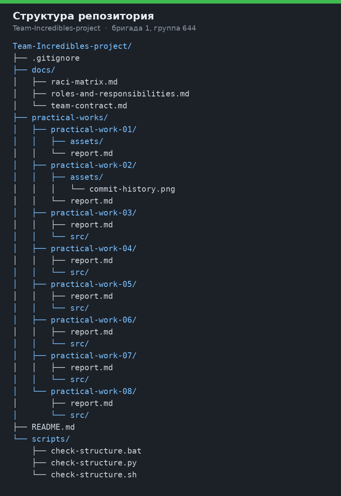
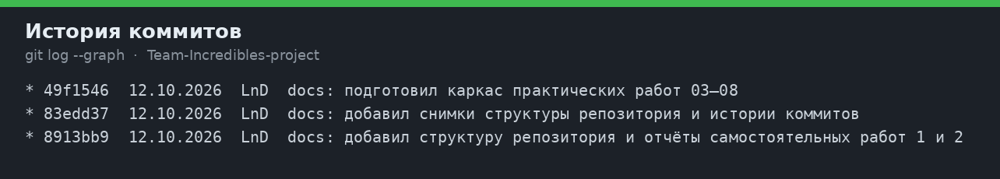

# Самостоятельная работа 2. Репозиторий проекта и распределение ответственности в Git

| | |
|---|---|
| Дисциплина | Введение в профессиональную деятельность |
| Группа | 644, бригада № 1 |
| Команда | Incredibles |
| Участники | Гужва Д. А., Алымова В. А., Акилина А. А., Алоян Н. Р., Евстигнеев А. А. |

## 1. Учётные записи и репозиторий

Командный репозиторий создан на GitHub учётной записью **arsLnD**:

https://github.com/arsLnD/Team-Incredibles-project

Имя репозитория соответствует команде Incredibles и формату `team-<название_команды>-project`.

| Участник | Роль в команде |
|---|---|
| Гужва Дарья | Аналитик |
| Алымова Виктория | UX/UI-дизайнер |
| Алоян Натали | Тестировщик |
| Акилина Анастасия | Разработчик |
| Евстигнеев Арсений | Менеджер проекта |

История репозитория ведётся от учётной записи arsLnD (LnD). Роли участников в работе с Git заданы ниже и не зависят от того, с какой учётной записи отправлен коммит.

## 2. Структура

```text
team-incredibles-project/
├── README.md
├── docs/
│   ├── team-contract.md
│   ├── roles-and-responsibilities.md
│   └── raci-matrix.md
├── practical-works/
│   ├── practical-work-01/
│   │   ├── report.md
│   │   └── assets/
│   ├── practical-work-02/
│   │   ├── report.md
│   │   └── assets/
│   ├── practical-work-03/ … practical-work-08/
│   │   ├── report.md
│   │   └── src/
├── scripts/
│   ├── check-structure.py
│   ├── check-structure.sh
│   └── check-structure.bat
└── .gitignore
```

| Путь | Содержание |
|---|---|
| `README.md` | Команда, состав, ссылки на документы |
| `docs/team-contract.md` | Чат Telegram, правила решений и работы с ветками |
| `docs/roles-and-responsibilities.md` | Роли, стандарты, трудовые функции, эссе, обязанности в Git |
| `docs/raci-matrix.md` | Матрица RACI по задачам команды и репозитория |
| `practical-works/practical-work-01/report.md` | Отчёт самостоятельной работы 1 |
| `practical-works/practical-work-02/report.md` | Этот отчёт |
| `assets/` | Снимки структуры и истории коммитов |
| `src/` | Код практических работ 03–08, когда они будут выполнены |
| `scripts/` | Проверка обязательной структуры |
| `.gitignore` | Служебные файлы среды, сборки и секреты |



## 3. Кто за что отвечает в Git

Распределение взято из ролей самостоятельной работы 1. Менеджер проекта — Евстигнеев Арсений — принимает результат. Разработчик — Акилина Анастасия — ведёт репозиторий. Тестировщик — Алоян Натали — проверяет изменения перед слиянием.

| Обязанность | R | A |
|---|---|---|
| Создание и настройка репозитория | Акилина Анастасия, разработчик | Евстигнеев Арсений, менеджер проекта |
| Структура папок и файлов | Акилина Анастасия; каждый участник в своём разделе | Евстигнеев Арсений |
| Отчёты | Гужва Дарья сводит текст, остальные дают свои разделы | Евстигнеев Арсений |
| Коммиты | Автор изменения | Евстигнеев Арсений |
| Проверка перед слиянием | Алоян Натали, тестировщик | Евстигнеев Арсений |
| Слияние в `main` | Евстигнеев Арсений | Евстигнеев Арсений |
| Сохранность истории | Все участники | Евстигнеев Арсений |

## 4. История коммитов



По `git log` видно автора, дату и сообщение каждого коммита. Вклад в конкретный файл дополнительно показывает `git blame`.

## 5. Вывод

Репозиторий собрал договорённости команды, роли и отчёты в одном дереве. Матрица RACI из первой работы перенесена на действия в Git: у создания репозитория, проверки и слияния есть исполнитель и один ответственный. История коммитов фиксирует, какое изменение внесено и кем оно подписано, поэтому вклад не нужно восстанавливать по переписке.

## 6. Ответы на контрольные вопросы

1. Репозиторий — хранилище файлов проекта и истории их изменений. Он нужен, чтобы команда работала в одной версии и могла вернуться к прошлой.
2. Git даёт общую историю, работу в отдельных ветках и автора у каждого изменения.
3. Коммит — зафиксированный снимок изменений. Сообщение говорит, что сделано, например: `docs: добавил отчёт самостоятельной работы 2`.
4. Ветка — отдельная линия истории. `main` хранит принятую версию. Рабочая ветка нужна, чтобы незаконченное изменение не становилось общей версией до проверки.
5. Pull Request — запрос влить ветку в другую. Автор показывает изменения, проверяющий смотрит их до слияния, роль с буквой A решает, что результат можно принять.
6. В `git log` у коммита есть автор и сообщение. По файлу то же показывает `git blame`.
7. Отдельная учётная запись нужна, чтобы коммиты и запросы на слияние были привязаны к человеку, а не к общему логину на всю бригаду.
