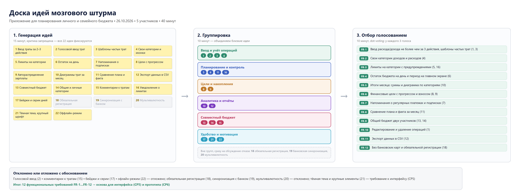

# Самостоятельная работа 4. Выявление функциональных требований методом мозгового штурма

| | |
|---|---|
| Дисциплина | Введение в профессиональную деятельность |
| Группа | 644, бригада № 1 |
| Команда | Incredibles |
| Проект | приложение для планирования личного и семейного бюджета |

## Состав команды и участие в работе

| Участник | Роль | Вклад в СР4 |
|---|---|---|
| Гужва Дарья | Аналитик | Фасилитация генерации идей, группировка, формулировка итоговых требований |
| Алымова Виктория | UX/UI-дизайнер | Генерация идей, оценка реализуемости в интерфейсе, участие в отборе |
| Алоян Натали | Тестировщик | Фиксация всех идей без отбора, контроль правил штурма, проверка формулировок требований |
| Акилина Анастасия | Разработчик | Оценка технической реализуемости идей, участие в отборе |
| Евстигнеев Арсений | Менеджер проекта | Организация и ведение штурма, модерация голосования, оформление отчёта |

---

## 1. Цель и связь с предыдущей работой

Цель работы — собрать перечень возможных функций продукта командным мозговым штурмом и на его основе сформулировать итоговый перечень функциональных требований.

В СР3 команда определила три сегмента целевой аудитории (студенты, молодые специалисты, семьи), их потребности и проблемы, а также зафиксировала единое видение: главный принцип продукта — «простота ввода и ясность результата». Мозговой штурм опирается на эти потребности: идеи генерировались под вопрос «какие функции помогут нашим сегментам решить их задачи», а отбор проверялся соответствием потребностям аудитории.

## 2. Проведение мозгового штурма

**Дата и место:** 26.10.2026, аудиторное занятие (очно).
**Участники:** все пять членов команды. Ведущий — менеджер проекта (Евстигнеев Арсений), секретарь — тестировщик (Алоян Натали).
**Длительность:** 40 минут.

Правила штурма (напомнил ведущий перед началом):

1. На этапе генерации критика запрещена — любая идея фиксируется.
2. Не обсуждаем реализацию: «как» важно потом, сейчас важно «что».
3. Говорим по очереди, не перебиваем.
4. Одна идея — одна запись (стикер).
5. Отбор и критика — только на отдельном этапе.

Ход штурма:

| Этап | Длительность | Содержание |
|---|---|---|
| Подготовка | 5 мин | Формулировка вопроса штурма, напоминание правил, раздача стикеров |
| Генерация идей | 15 мин | Каждый участник письменно предложил идеи функций; секретарь собрал все стикеры на доску без отбора |
| Группировка | 10 мин | Команда совместно разложила стикеры по темам, объединив близкие идеи |
| Отбор | 10 мин | Точечное голосование (dot-voting): у каждого участника 3 голоса, можно отдать несколько голосов одной идее |

Итог штурма зафиксирован на доске идей (см. рис. 1 в разделе 4).

## 3. Полный список сгенерированных идей

На этапе генерации предложено 22 идеи. Список приводится полностью, без отбора (нумерация условная, по порядку фиксации на доске):

1. Быстрый ввод траты за 2–3 действия.
2. Голосовой ввод трат.
3. Шаблоны частых трат («кофе», «проезд»).
4. Свои категории с иконками.
5. Лимиты на категории с предупреждениями.
6. Остаток на день на главном экране.
7. Напоминания о регулярных платежах и подписках.
8. Финансовые цели с прогрессом.
9. Автораспределение зарплаты по категориям и целям.
10. Диаграммы «куда ушли деньги» за месяц.
11. Сравнение плана и факта за период.
12. Экспорт данных в CSV.
13. Совместный бюджет для двоих/семьи.
14. Общие и личные категории в совместном бюджете.
15. Комментарии к тратам для семьи.
16. Уведомления о приближении к лимиту.
17. Бейджи и «серии дней» учёта для мотивации.
18. Обязательная регистрация по номеру телефона.
19. Автоматическая синхронизация с банком.
20. Мультивалютность и курсы валют.
21. Тёмная тема и крупные элементы.
22. Оффлайн-режим без интернета.

## 4. Группировка и отбор идей

### 4.1. Группировка

Шесть тематических групп (идеи из списка выше обозначены номерами):

| Группа | Идеи |
|---|---|
| Ввод и учёт операций | 1, 2, 3, 4 |
| Планирование и контроль | 5, 6, 11, 16 |
| Цели и накопления | 8, 9 |
| Аналитика и отчёты | 10, 12 |
| Совместный бюджет | 13, 14, 15 |
| Удобство и мотивация | 17, 21, 22 |

Идеи 18, 19 и 20 не вошли в группы: при группировке выяснилось, что они противоречат допущениям о доверии к продукту, и команда вынесла их на отдельное обсуждение (см. 4.2).

*Рис. 1. Доска идей: генерация → группировка → отбор.*

### 4.2. Отбор с обоснованием

Отбор проводился точечным голосованием (у каждого участника 3 голоса). В итоговый перечень вошли идеи, получившие голоса минимум трёх участников и не противоречащие единому видению продукта из СР3.

**Отобрано в требования:** идеи 1, 3, 4, 5, 6, 7, 8, 10, 11, 12, 13, 14, 16 (в формулировках FR-1 — FR-12 ниже).

**Отклонено или отложено:**

| Идея | Решение | Обоснование |
|---|---|---|
| 2. Голосовой ввод | Отложено | Мало голосов; сложно проверить в учебном прототипе; не решает главную боль («лень вносить» — решается шаблонами) |
| 9. Автораспределение зарплаты | Отложено | Часть механики целей (FR-6): расчёт рекомендуемого взноса; полный автомат — следующая итерация |
| 15. Комментарии к тратам | Отложено | Связано с гипотезой 3 (совместный бюджет); вернёмся после проверки в СР7 |
| 17. Бейджи и «серии дней» | Отложено | Геймификация вторична, есть риск отвлечь от главного сценария; напоминания (FR-7) важнее |
| 18. Обязательная регистрация | Отклонено | Противоречит гипотезе 5 (доверие): барьер на входе без пользы для учёта |
| 19. Синхронизация с банком | Отклонено | Противоречит отказу от банковских данных; недостижимо в прототипе |
| 20. Мультивалютность | Отклонено | За рамками учебного проекта; ни один из сегментов не назвал это потребностью |
| 21. Тёмная тема, крупные элементы | Передано в СР5 | Это требование к интерфейсу, а не функция; учтём при макетах |
| 22. Оффлайн-режим | Отложено | Прототип веб-ориентирован; ограничение зафиксировано для СР6–СР7 |

## 5. Итоговый перечень функциональных требований

| № | Функциональное требование | Источник (идеи) |
|---|---|---|
| FR-1 | Пользователь может внести расход или доход не более чем за 3 действия (сумма → категория → сохранение), в том числе через шаблон частой траты | 1, 3 |
| FR-2 | Пользователь может создавать и редактировать собственные категории доходов и расходов | 4 |
| FR-3 | Пользователь может установить лимит на категорию за период и получить предупреждение при приближении к нему | 5, 16 |
| FR-4 | Главный экран показывает остаток бюджета на текущий день и на период | 6 |
| FR-5 | Система формирует итоги месяца: суммарные доходы и расходы и диаграмму распределения расходов по категориям | 10 |
| FR-6 | Пользователь может создать финансовую цель (сумма, срок), видеть прогресс и рекомендуемый ежемесячный взнос | 8, 9 |
| FR-7 | Система напоминает о запланированных регулярных платежах и подписках | 7 |
| FR-8 | Пользователь может сравнить запланированный бюджет с фактическими тратами за месяц | 11 |
| FR-9 | Пользователь может вести общий бюджет с другим участником: общие и личные категории, видимость операций для обоих | 13, 14 |
| FR-10 | Пользователь может редактировать и удалять ошибочно внесённые операции | 1 (доработка на отборе) |
| FR-11 | Пользователь может экспортировать свои данные (CSV) | 12 |
| FR-12 | Приложение работает без привязки банковских карт и без обязательной регистрации | 18 (инверсия после отклонения) |

## 6. Соотношение требований с потребностями аудитории

| Требования | Потребности сегментов (из СР3) |
|---|---|
| FR-1, FR-4, FR-10 | Все сегменты: быстро записать трату; видеть остаток; исправить ошибку. Основной сценарий для сегмента 1 («внести за пару секунд», «сколько можно потратить сегодня») |
| FR-2, FR-3, FR-5 | Все сегменты: категории, лимиты, итоги месяца — базовые потребности из СР3 |
| FR-6, FR-7, FR-8 | Сегмент 2 (и частично семьи): цели накопления, регулярные платежи, сравнение плана и факта |
| FR-9 | Сегмент 3: общий бюджет, общие и личные категории, прозрачность расходов |
| FR-11, FR-12 | Все сегменты: «не потерять данные», доверие (нет банковских карт, нет обязательной регистрации) |

Таким образом, все двенадцать требований выведены из потребностей, зафиксированных в СР3: базовые учётные функции покрывают общие потребности всех сегментов, а расширенные функции (цели, план/факт, совместный бюджет) — специфические потребности сегментов 2 и 3. Ничего в перечень не вошло «от себя»: каждое требование привязано к идее штурма, а каждая отобранная идея — к потребности аудитории.

## 7. Вывод

Командой проведён мозговой штурм по правилам метода: 40 минут, пять участников, критика отложена до отдельного этапа. Сгенерировано 22 идеи, все зафиксированы без отбора. Совместная группировка выделила шесть тем; точечным голосованием отобраны 13 идей, из которых сформулированы 12 функциональных требований. Часть идей отклонена или отложена с явным обоснованием — в первую очередь те, что противоречат доверию аудитории (обязательная регистрация, банковская синхронизация) или выходят за рамки учебного проекта (мультивалютность). Итоговый перечень требований полностью прослеживается до потребностей целевой аудитории из СР3 и служит входом для проектирования интерфейса (СР5) и прототипа (СР6).

## 8. Ответы на контрольные вопросы

**1. Что такое мозговой штурм и каковы его основные правила?**
Метод коллективной генерации идей, при котором участники свободно предлагают варианты, а критика и отбор откладываются на отдельный этап. Основные правила: не критиковать идеи на генерации, не обсуждать реализацию, говорить по очереди, фиксировать всё.

**2. Почему на этапе генерации идей критика запрещена?**
Критика тормозит генерацию: участники начинают фильтровать идеи до того, как те прозвучали, и предлагают меньше. Запрет критики даёт полный список вариантов, а отбор проводится потом, когда все идеи видны.

**3. Что такое функциональное требование?**
Описание функции, которую система должна предоставить пользователю: что пользователь может сделать и как система реагирует. В нашей работе — FR-1…FR-12 (например, «внести расход не более чем за 3 действия»).

**4. Как связаны целевая аудитория и функциональные требования?**
Требования выводятся из потребностей аудитории: функция имеет смысл, только если решает задачу пользователя. Поэтому штурм начинался с потребностей сегментов из СР3, а отбор идей проверялся их соответствием этим потребностям.

**5. Зачем фиксировать все идеи, даже «неудачные»?**
«Неудачная» идея может стать основой удачной на этапе группировки, а отклонённые идеи с обоснованием показывают, что команда рассматривала варианты и отказ от них осознан. Полный список также доказывает объём генерации при защите работы.

## 9. Размещение в репозитории

- `practical-works/practical-work-04/report.md` — настоящий отчёт;
- `practical-works/practical-work-04/assets/ideas-board.png` — доска идей мозгового штурма (генерация, группировка, отбор).
