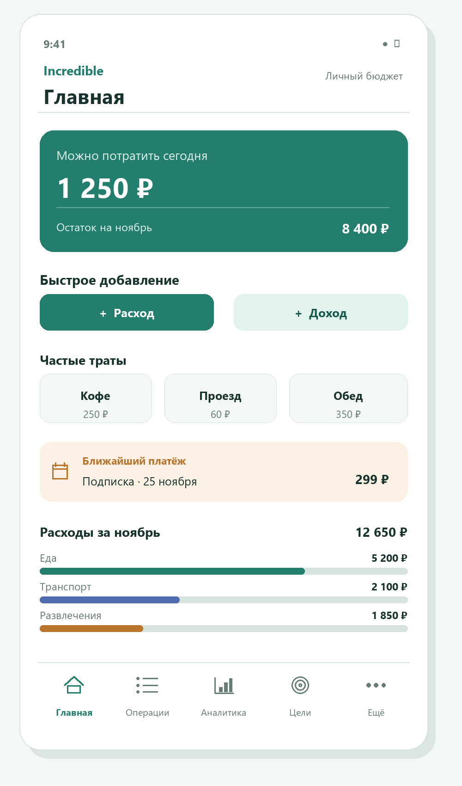
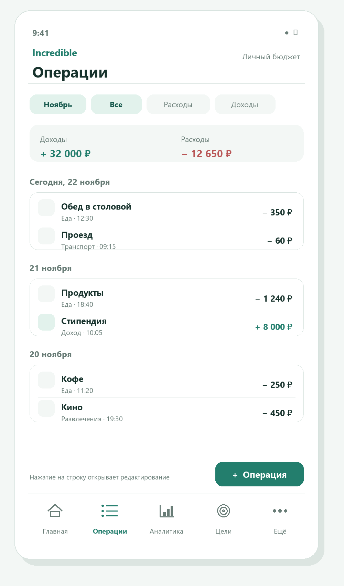
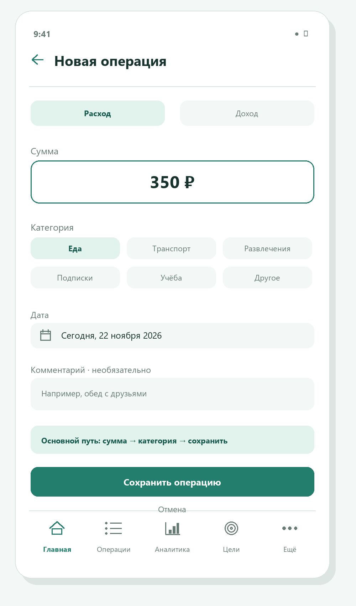
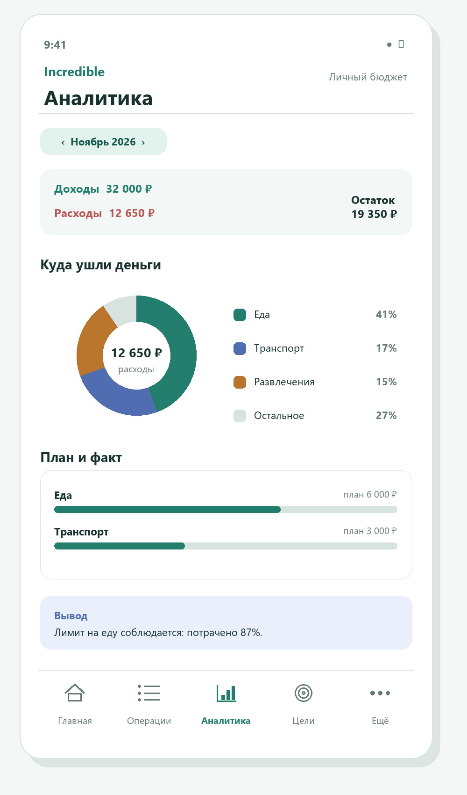
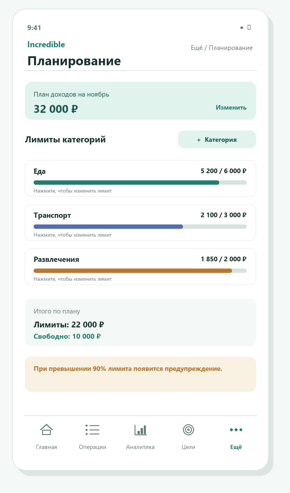
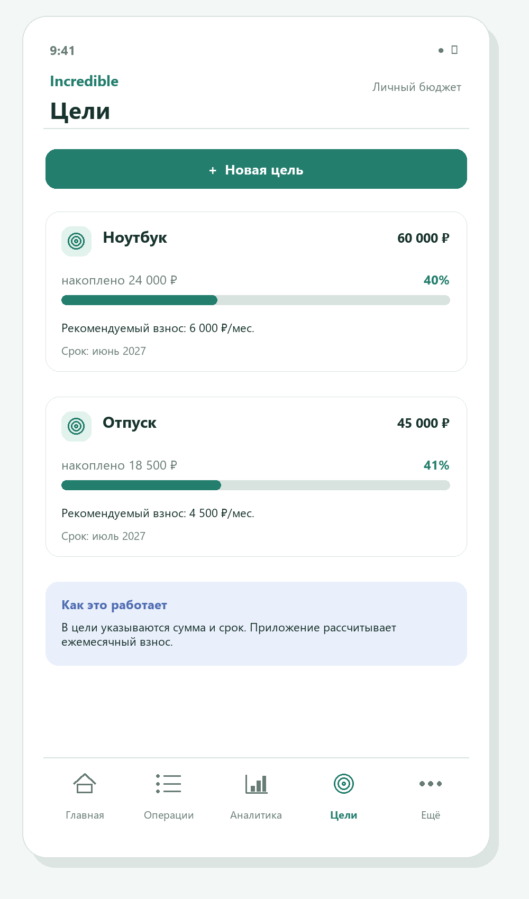
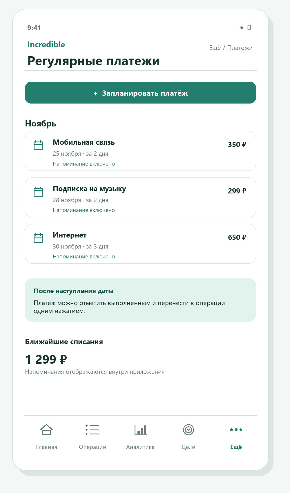
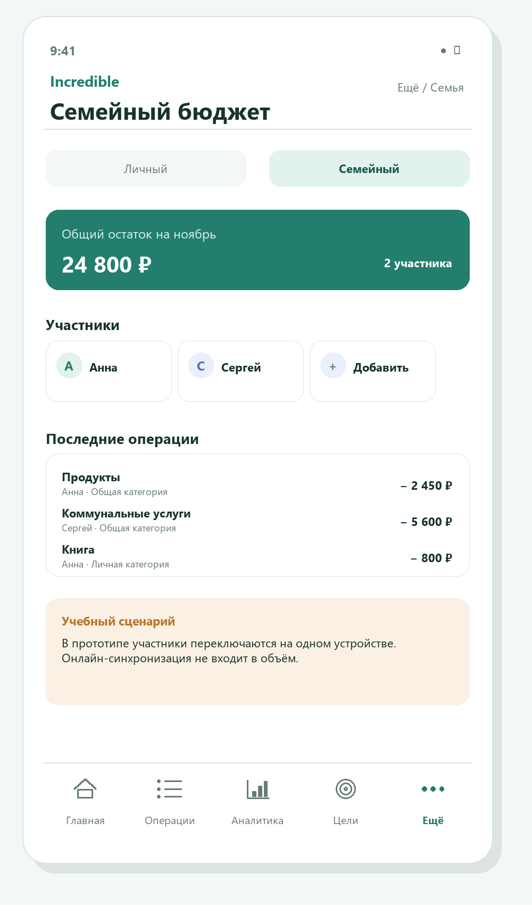
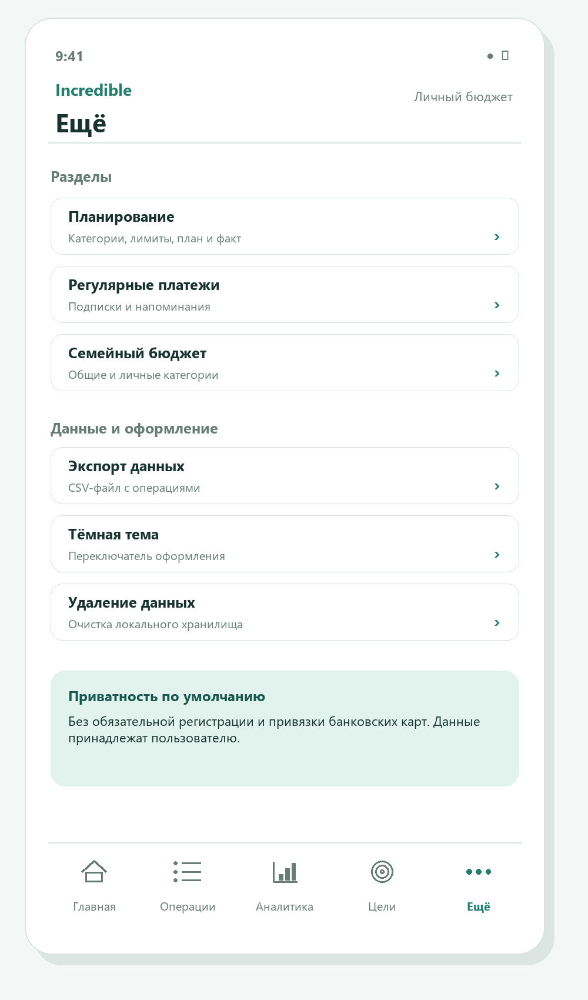
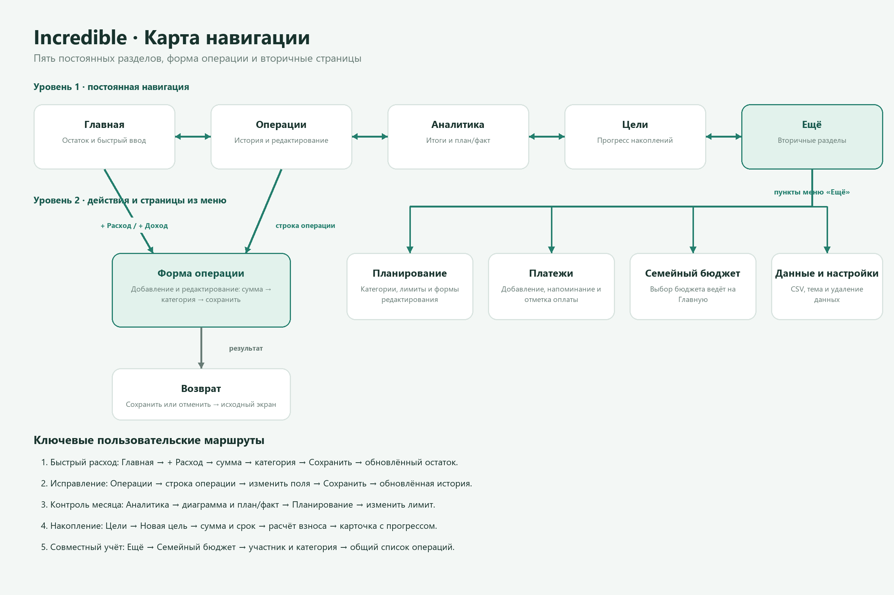

# Самостоятельная работа 5. Разработка интерфейса

| | |
|---|---|
| Дисциплина | Введение в профессиональную деятельность |
| Команда | Incredibles, группа 644, бригада № 1 |
| Проект | **Incredible** — приложение для планирования личного и семейного бюджета |
| Тип интерфейса | Адаптивный веб-интерфейс с приоритетом мобильной версии |
| Результат этапа | Структура из девяти основных представлений, эскизы, карта навигации и индивидуальные отчёты участников |

## Состав команды и распределение работы

| Участник | Роль | Вклад в СР5 |
|---|---|---|
| Гужва Дарья | Аналитик | Связывает требования FR-1—FR-12 с экранами, описывает пользовательские сценарии, поля данных и ограничения |
| Алымова Виктория | UX/UI-дизайнер | Проектирует структуру экранов, навигацию, визуальный стиль, компоненты и адаптивное поведение |
| Алоян Натали | Тестировщик | Проверяет полноту покрытия требований, непротиворечивость переходов и сценарии ошибок |
| Акилина Анастасия | Разработчик | Оценивает реализуемость макетов, предлагает компонентную архитектуру и простую модель данных для СР6 |
| Евстигнеев Арсений | Менеджер проекта | Формирует состав работ, контролирует объём решения, согласует результат и организует размещение материалов |

Подробные индивидуальные отчёты:

- [Гужва Дарья — аналитик](reports/Гужва_Дарья_СР5.docx);
- [Алымова Виктория — UX/UI-дизайнер](reports/Алымова_Виктория_СР5.docx);
- [Алоян Натали — тестировщик](reports/Алоян_Натали_СР5.docx);
- [Акилина Анастасия — разработчик](reports/Акилина_Анастасия_СР5.docx);
- [Евстигнеев Арсений — менеджер проекта](reports/Евстигнеев_Арсений_СР5.docx).

## 1. Цель и исходные данные

Цель работы — спроектировать понятный интерфейс приложения **Incredible** на основе целевой аудитории из СР3 и функциональных требований из СР4. На этом этапе создаются не программный продукт, а структура экранов, состав элементов, навигация и визуальные эскизы. Работающий прототип будет разработан отдельно в СР6.

При проектировании использованы следующие исходные положения:

1. Основной сегмент — студенты, которым важны быстрый ввод траты и понятный остаток на день.
2. Вторичный сегмент — молодые специалисты, которым нужны цели, регулярные платежи и сравнение плана с фактом.
3. Расширяющий сегмент — семьи, которым нужны общий бюджет, общие и личные категории.
4. Главный принцип продукта — «простота ввода и ясность результата».
5. Основные сценарии выполняются на смартфоне; компьютерная версия использует ту же информационную архитектуру.
6. Приложение не требует обязательной регистрации, банковских карт и синхронизации с банком.
7. В учебный прототип не включаются сложные серверные функции. Совместный бюджет демонстрируется локально на одном устройстве, а напоминания отображаются внутри приложения.

## 2. Выбранный тип интерфейса и обоснование

Выбран **адаптивный веб-интерфейс**. На смартфоне используется одноколоночная компоновка и нижняя панель навигации. На компьютере та же структура разворачивается в боковое меню и рабочую область с карточками. Это не два разных продукта: названия разделов, порядок действий и состав форм сохраняются.

Такой вариант выбран потому, что:

- веб-страница доступна на смартфоне и компьютере без установки;
- адаптивный интерфейс соответствует контекстам «смартфон + ноутбук», выявленным в СР3;
- пять постоянных разделов помещаются в нижней навигации и не требуют глубокой иерархии;
- карточки, списки, формы и диаграммы достаточно просты для последующей реализации;
- отсутствие регистрации позволяет сразу открыть главный экран и выполнить основной сценарий.

Для СР5 выбраны детализированные эскизы средней точности: они показывают реальные подписи, иерархию, состояния и примерные данные, но не заменяют работающий прототип.

## 3. Информационная архитектура

### 3.1. Основные разделы

Постоянная навигация содержит пять пунктов:

1. **Главная** — текущий финансовый результат и быстрый ввод.
2. **Операции** — история доходов и расходов.
3. **Аналитика** — итоги месяца, категории и план/факт.
4. **Цели** — накопления и рекомендуемые взносы.
5. **Ещё** — планирование, регулярные платежи, семейный бюджет, данные и оформление.

В «Ещё» вынесены функции, которые нужны реже. Благодаря этому основная навигация не перегружена, но все требования остаются доступны максимум за два перехода.

### 3.2. Перечень экранов

| ID | Экран | Назначение | Требования |
|---|---|---|---|
| S01 | Главная | Показать остаток на день и период, быстро добавить операцию, открыть шаблон и увидеть ближайший платёж | FR-1, FR-3, FR-4, FR-7 |
| S02 | Операции | Просмотреть, отфильтровать, добавить, изменить или удалить операции | FR-1, FR-10 |
| S03 | Форма операции | Внести доход или расход, выбрать категорию, при необходимости изменить дату и комментарий | FR-1, FR-10, FR-12 |
| S04 | Аналитика | Показать доходы, расходы, распределение по категориям и сравнение плана с фактом | FR-5, FR-8 |
| S05 | Планирование | Управлять категориями и лимитами, видеть свободную сумму и предупреждения | FR-2, FR-3, FR-8 |
| S06 | Цели | Создать цель, указать сумму и срок, видеть прогресс и рекомендуемый взнос | FR-6 |
| S07 | Регулярные платежи | Планировать подписки и обязательные платежи, показывать внутренние напоминания | FR-7 |
| S08 | Семейный бюджет | Переключать личный и семейный режим, участников, общие и личные категории | FR-9 |
| S09 | Ещё | Открыть вторичные разделы, экспортировать CSV, изменить тему или удалить данные | FR-2, FR-3, FR-7, FR-9, FR-11, FR-12 |

### 3.3. Вспомогательные формы

Чтобы не увеличивать число основных страниц, локальные действия выполняются в небольших формах или модальных окнах:

- создание и редактирование категории;
- изменение лимита категории;
- создание и редактирование цели;
- добавление регулярного платежа;
- добавление локального участника семейного бюджета;
- подтверждение удаления операции или всех данных.

Каждая форма имеет явные действия «Сохранить» и «Отмена». Операции с удалением требуют подтверждения.

## 4. Состав элементов основных экранов

### 4.1. S01. Главная

| Элемент | Назначение и поведение |
|---|---|
| Название Incredible и режим «Личный бюджет» | Показывает продукт и текущий контекст данных |
| Карточка «Можно потратить сегодня» | Главный результат для студента; крупная сумма считывается первой |
| Остаток на период | Показывает свободный остаток с учётом плана, обязательных платежей и отложенных сумм |
| Кнопки «+ Расход» и «+ Доход» | Открывают S03 с заранее выбранным типом операции |
| Шаблоны «Кофе», «Проезд», «Обед» | Сокращают ввод частой траты: открывают форму с заполненными суммой и категорией |
| Карточка ближайшего платежа | Показывает название, дату и сумму; ведёт к S07 |
| Блок расходов за месяц | Показывает общую сумму и три заметные категории; ведёт к S04 |
| Нижняя навигация | Обеспечивает переход между пятью постоянными разделами |

«Фактический остаток» в аналитике и «свободный остаток» на главной не смешиваются: первый равен доходам минус учтённые расходы, второй дополнительно учитывает запланированные обязательства. Подписи должны явно различать эти значения.

### 4.2. S02. Операции

| Элемент | Назначение и поведение |
|---|---|
| Выбор месяца | Ограничивает список выбранным периодом |
| Фильтры «Все», «Расходы», «Доходы» | Изменяют видимые записи без перехода на другую страницу |
| Сводка доходов и расходов | Показывает итоги для текущего фильтра и месяца |
| Список, сгруппированный по датам | Облегчает поиск недавних записей |
| Строка операции | Показывает название, категорию, время и сумму; нажатие открывает S03 в режиме редактирования |
| Кнопка «+ Операция» | Открывает S03 для новой записи |
| Удаление в режиме редактирования | Удаляет ошибочную запись после подтверждения |

Пустой список не должен выглядеть как ошибка: отображаются текст «За этот период операций нет» и кнопка добавления.

### 4.3. S03. Форма операции

| Элемент | Назначение и поведение |
|---|---|
| Переключатель «Расход / Доход» | Задаёт тип операции и меняет доступные категории |
| Поле суммы | Обязательное поле; принимает положительное число в рублях |
| Сетка категорий | Позволяет выбрать категорию одним нажатием |
| Дата | По умолчанию равна текущему дню; изменение необязательно |
| Комментарий | Необязательное поле, не увеличивает обязательный основной путь |
| «Сохранить операцию» | Проверяет сумму и категорию, сохраняет запись и возвращает на исходный экран |
| «Отмена» и стрелка назад | Закрывают форму без сохранения |

Основной сценарий состоит из трёх действий: ввести сумму, выбрать категорию, сохранить. Если форма открыта шаблоном, сумма и категория уже заполнены. При ошибке поле выделяется, а сообщение размещается рядом с ним.

### 4.4. S04. Аналитика

| Элемент | Назначение и поведение |
|---|---|
| Переключатель месяца | Изменяет период всех показателей |
| Сводка доходов, расходов и фактического остатка | Даёт итог месяца в числовом виде |
| Кольцевая диаграмма | Показывает доли категорий в расходах |
| Легенда с подписями и процентами | Позволяет понять диаграмму без опоры только на цвет |
| Блок «План и факт» | Сравнивает лимит с фактическими тратами по категориям |
| Текстовый вывод | Коротко объясняет состояние, например «потрачено 87% лимита» |

При отсутствии расходов вместо пустой диаграммы выводится сообщение и предложение добавить операцию. Подписи и проценты сохраняются и в тёмной теме.

### 4.5. S05. Планирование

| Элемент | Назначение и поведение |
|---|---|
| План доходов на месяц | Задаёт исходную сумму планирования |
| Кнопка «+ Категория» | Открывает форму названия, типа и визуального обозначения категории |
| Карточка категории | Показывает фактические траты, лимит и процент использования |
| Полоса прогресса | Даёт визуальный сигнал о приближении к лимиту |
| Подсказка «Нажмите, чтобы изменить лимит» | Открывает редактирование выбранной категории |
| Итоги «Лимиты» и «Свободно» | Показывают распределённую и ещё не распределённую суммы |
| Предупреждение | Поясняет порог уведомления, принятый для макета — 90% |

Цвет дублируется числом и текстом. При превышении лимита появляется не только красная полоса, но и явная подпись «Лимит превышен на … ₽».

### 4.6. S06. Цели

| Элемент | Назначение и поведение |
|---|---|
| «+ Новая цель» | Открывает форму с названием, суммой и сроком |
| Карточка цели | Показывает целевую и накопленную суммы |
| Полоса и процент прогресса | Дублируют друг друга и показывают степень достижения |
| Рекомендуемый взнос | Рассчитывается как оставшаяся сумма, распределённая по оставшимся месяцам |
| Срок | Показывает планируемую дату достижения |
| Блок объяснения | Помогает понять расчёт без обращения к документации |

Если срок наступил, а сумма не достигнута, интерфейс предлагает изменить срок или взнос, а не сообщает только о неудаче.

### 4.7. S07. Регулярные платежи

| Элемент | Назначение и поведение |
|---|---|
| «+ Запланировать платёж» | Открывает форму названия, суммы, даты и периода повторения |
| Карточка платежа | Показывает название, дату и сумму |
| Срок напоминания | Например, «за 2 дня»; настраивается при создании |
| Состояние напоминания | Показывает, что внутреннее напоминание включено |
| Отметка выполнения | Создаёт соответствующую операцию и переносит следующий платёж |
| Сумма ближайших списаний | Помогает учесть обязательные расходы при планировании |

На главной и в разделе платежей показываются внутренние напоминания. Push-уведомления, SMS и интеграция с календарём не заявляются.

### 4.8. S08. Семейный бюджет

| Элемент | Назначение и поведение |
|---|---|
| Переключатель «Личный / Семейный» | Меняет текущий набор данных и возвращает пользователя на главную с выбранным режимом |
| Общий остаток | Показывает результат семейного режима |
| Счётчик участников | Показывает размер локальной группы |
| Карточки участников | Позволяют выбрать, от имени кого вносится операция |
| «Добавить» | Добавляет локального участника без приглашения по сети |
| Общая история операций | Показывает автора и тип категории каждой записи |
| Пояснение ограничения | Честно сообщает, что онлайн-синхронизация не входит в учебный прототип |

Общие категории участвуют в семейной аналитике, личные сохраняют авторство и отображаются с соответствующей пометкой. Это демонстрация пользовательского сценария на одном устройстве, а не многопользовательская серверная система.

### 4.9. S09. Ещё

| Элемент | Назначение и поведение |
|---|---|
| «Планирование» | Открывает S05 |
| «Регулярные платежи» | Открывает S07 |
| «Семейный бюджет» | Открывает S08 |
| «Экспорт данных» | Формирует CSV с операциями и сообщает о результате |
| «Тёмная тема» | Переключает оформление без изменения структуры |
| «Удаление данных» | Запрашивает подтверждение и очищает локальные данные |
| Блок приватности | Напоминает об отсутствии обязательной регистрации и банковских карт |

## 5. Карта навигации

### 5.1. Основные переходы

- Пять постоянных разделов связаны нижней навигацией на смартфоне и боковым меню на компьютере.
- С главной и из истории операций открывается общая форма S03. После сохранения или отмены пользователь возвращается в исходный раздел.
- Из «Ещё» открываются планирование, платежи, семейный бюджет и действия с данными.
- Выбор личного или семейного режима меняет контекст и ведёт на главную.
- Карточка ближайшего платежа ведёт из главной в S07.
- Блок месячных расходов ведёт из главной в S04.
- Из аналитики можно перейти к планированию для изменения лимита.

### 5.2. Пять ключевых маршрутов

| Сценарий | Маршрут | Результат |
|---|---|---|
| Быстрый расход | S01 → «+ Расход» → S03 → сумма → категория → «Сохранить» | Новая запись и обновлённый остаток |
| Исправление ошибки | S02 → строка операции → S03 → изменение → «Сохранить» | Обновлённые запись, история и показатели |
| Контроль месяца | S04 → «План и факт» → S05 → изменение лимита | Новый лимит и обновлённое сравнение |
| Постановка цели | S06 → «Новая цель» → сумма и срок → сохранение | Карточка цели с прогрессом и взносом |
| Совместный учёт | S09 → S08 → выбор участника → добавление операции | Операция с автором в общем списке |

### 5.3. Правила возврата и обратной связи

1. Активный пункт навигации выделяется цветом и полужирной подписью.
2. Вторичные страницы сохраняют пункт «Ещё» активным и показывают контекст в заголовке.
3. Форма сообщает о сохранении коротким уведомлением.
4. Успешное действие не оставляет пользователя на промежуточном экране.
5. Отмена не меняет данные; удаление требует подтверждения.
6. Ни одна кнопка на эскизах не является декоративной: каждая имеет описанный переход или изменение состояния.

## 6. Компонентная архитектура интерфейса

Архитектура описывает, как элементы связаны между собой, и одновременно ограничивает сложность будущей реализации.

### 6.1. Общий каркас

Все страницы используют один каркас:

- **шапка** — название продукта, заголовок, текущий режим или возврат;
- **рабочая область** — карточки, списки, диаграммы и формы конкретного экрана;
- **постоянная навигация** — пять разделов;
- **область обратной связи** — сообщения о сохранении, ошибках и предупреждениях;
- **диалоговый слой** — локальные формы и подтверждения.

### 6.2. Повторно используемые компоненты

| Компонент | Где используется | Назначение |
|---|---|---|
| `SummaryCard` | Главная, аналитика, семейный бюджет | Крупный финансовый показатель с пояснением |
| `OperationItem` | Операции, семейный бюджет | Единый формат записи и точка редактирования |
| `CategoryChip` | Форма операции, планирование | Выбор категории одним действием |
| `ProgressBar` | Лимиты, цели, план/факт | Визуальное отображение отношения двух величин |
| `MonthSwitcher` | Операции, аналитика, планирование | Единый выбор периода |
| `FormDialog` | Операции, категории, цели, платежи | Единые правила сохранения и отмены |
| `EmptyState` | Списки, диаграммы, цели | Объяснение пустого состояния и следующее действие |
| `AppNavigation` | Все основные экраны | Нижняя панель или боковое меню в зависимости от ширины |

Это логические компоненты интерфейса, а не обязательство использовать конкретную библиотеку. В СР6 они могут быть реализованы простыми блоками HTML/CSS и функциями JavaScript.

### 6.3. Связь данных и представлений

Для будущего прототипа предполагается единое локальное состояние:

- список операций;
- категории и лимиты;
- выбранный месяц;
- цели;
- регулярные платежи;
- режим «личный / семейный» и участники;
- настройки оформления.

Главная, история, аналитика и план/факт используют одни и те же операции. Поэтому после добавления или редактирования записи обновляются все зависимые суммы. Такая связь исключает противоречивые значения на разных экранах. В рамках СР5 эта модель зафиксирована концептуально; программная реализация не выполняется.

## 7. Визуальный стиль и адаптивность

### 7.1. Стиль

- Основной цвет — зелёно-бирюзовый; он связан со спокойствием, контролем и положительными действиями.
- Фон светлый, рабочие элементы размещаются на белых карточках.
- Тёмный зелёно-серый текст используется вместо чистого чёрного для более мягкого чтения.
- Синий и охристый применяются только как дополнительные акценты в графиках и предупреждениях.
- Основные суммы крупнее вторичных подписей; визуальная иерархия соответствует важности информации.
- Иконки всегда сопровождаются текстовыми подписями в навигации.

### 7.2. Мобильная и компьютерная версии

| Решение | Смартфон | Компьютер |
|---|---|---|
| Навигация | Нижняя панель из пяти пунктов | Левая боковая панель |
| Основной контент | Одна колонка | Рабочая область, карточки могут образовывать две колонки |
| Форма операции | Отдельный экран или полноразмерный диалог | Центральное модальное окно |
| Списки | Полная ширина | Ограниченная читаемая ширина |
| Диаграмма и легенда | Вертикально или компактно рядом | Рядом в расширенной карточке |

Не проектируются жесты как единственный способ действия. Основные функции доступны видимыми кнопками.

## 8. Обоснование решений через целевую аудиторию

| Особенность аудитории | Решение интерфейса | Ожидаемый эффект |
|---|---|---|
| Студент хочет внести трату за несколько секунд | Кнопки расхода и дохода на главной, трёхшаговая форма, шаблоны | Сокращение основного сценария |
| Пользователь не понимает, сколько можно потратить | Самый крупный показатель — остаток на сегодня | Быстрый ответ без дополнительных переходов |
| Респонденты отмечают перегруженность интерфейсов | Пять основных разделов, вторичные функции в «Ещё» | Меньше одновременных стимулов |
| Молодым специалистам нужны цели и планирование | Отдельные «Цели» и «Планирование» с прогрессом и план/фактом | Поддержка долгосрочных сценариев |
| Семье нужна прозрачность | Автор и тип категории видны в общей истории | Понятное разделение операций |
| Разный уровень владения техникой | Текстовые подписи, одинаковые формы, явные кнопки сохранения | Меньше необходимости обучения |
| Пользователи опасаются передавать финансовые данные | Нет экрана регистрации и привязки карты; есть пояснение приватности | Меньше барьеров на входе |
| Нужна работа на разных устройствах | Адаптивная компоновка с одной архитектурой | Единый опыт на телефоне и компьютере |

## 9. Покрытие функциональных требований

| Требование | Экраны и элементы | Как проверить на прототипе |
|---|---|---|
| FR-1. Доход/расход не более чем за 3 действия, шаблоны | S01, S02, S03: кнопки, сумма, категории, сохранение, шаблоны | Добавить расход и доход; открыть шаблон |
| FR-2. Собственные категории | S05: «+ Категория», редактирование | Создать категорию и выбрать её в операции |
| FR-3. Лимиты и предупреждения | S01, S05: прогресс, порог 90%, текст предупреждения | Изменить лимит и приблизить расход к границе |
| FR-4. Остаток на день и период | S01: две явно подписанные суммы | Добавить операцию и проверить обновление |
| FR-5. Итоги и диаграмма месяца | S04: суммы, кольцевая диаграмма, легенда | Сменить месяц и сравнить итоги |
| FR-6. Цели, прогресс, рекомендуемый взнос | S06: форма цели, прогресс, взнос, срок | Создать цель и пополнить её |
| FR-7. Регулярные платежи и напоминания | S01, S07: ближайший платёж, список, срок напоминания | Добавить платёж и открыть главную |
| FR-8. Сравнение плана и факта | S04, S05: полосы план/факт и лимиты | Изменить лимит и проверить аналитику |
| FR-9. Общий бюджет, общие и личные категории | S08, S03: режим, участники, автор и тип категории | Переключить режим и добавить локальную операцию |
| FR-10. Редактирование и удаление операций | S02, S03: строка, режим редактирования, подтверждение | Изменить сумму; удалить запись |
| FR-11. Экспорт CSV | S09: «Экспорт данных» | Скачать и открыть CSV |
| FR-12. Без карт и обязательной регистрации | S01, S09: прямой вход и пояснение приватности | Открыть приложение и выполнить сценарий без входа |

Все двенадцать требований имеют место в интерфейсе. Дополнительные функции, отклонённые в СР4 — банковская синхронизация, голосовой ввод, мультивалютность, обязательная регистрация и геймификация — в эскизы не добавлены.

## 10. Проверка интерфейса перед прототипированием

Для подготовки к СР6 определён минимальный чек-лист:

1. Из каждого основного раздела можно перейти в четыре других постоянных раздела.
2. Все вторичные страницы доступны из «Ещё».
3. Основной расход добавляется за сумма → категория → сохранение.
4. Обязательные поля и ошибки обозначены текстом.
5. Возврат и отмена не приводят к потере уже сохранённых данных.
6. Удаление операции и всех данных требует подтверждения.
7. Пустые состояния содержат следующее понятное действие.
8. Диаграммы имеют легенду, суммы и проценты.
9. Одни данные используются главной, историей, аналитикой и план/фактом.
10. Все кнопки имеют назначение; декоративных неработающих элементов в прототипе быть не должно.
11. Семейный режим не обещает сетевую синхронизацию.
12. Тёмная тема не меняет смысл и доступность элементов.

## 11. Ограничения и решения для реализации в СР6

Чтобы интерфейс был реализуем в короткий срок, заранее приняты ограничения:

- один адаптивный сайт без отдельных нативных приложений;
- локальное хранение данных в браузере;
- отсутствие сервера, учётных записей и банковских интеграций;
- локальная демонстрация семейного бюджета на одном устройстве;
- внутренние напоминания без системных push-уведомлений;
- простые CSS-диаграммы или компактная библиотека диаграмм без тяжёлой инфраструктуры;
- реальные формы, переходы, расчёты и CSV-экспорт только на следующем этапе, в СР6.

Эти ограничения не скрываются в интерфейсе и не противоречат уровню прототипа, заданному методичкой.

## 12. Ответы на контрольные вопросы

**1. Что такое пользовательский интерфейс?**  
Это совокупность экранов, элементов управления, текста, визуальных состояний и правил взаимодействия, через которые пользователь выполняет задачи в продукте.

**2. Какими качествами должен обладать удобный интерфейс?**  
Он должен быть понятным, последовательным, доступным, предсказуемым и устойчивым к ошибкам. Важные действия должны быть заметны, результаты — ясны, а навигация — не слишком глубокой.

**3. Что такое макет (эскиз) экрана и зачем он нужен?**  
Это заранее подготовленное представление структуры и содержания экрана. Он позволяет согласовать расположение элементов, подписи и переходы до программирования, снижая вероятность дорогостоящих переделок.

**4. Что такое навигация в интерфейсе?**  
Это система переходов между разделами и состояниями продукта. Она включает постоянное меню, кнопки действий, возвраты и понятное обозначение текущего места пользователя.

**5. Как потребности целевой аудитории влияют на дизайн интерфейса?**  
Они определяют приоритет экранов и элементов. Для студентов Incredible выносит на главную остаток и быстрый ввод; для молодых специалистов добавляет цели и план/факт; для семей — участников и общие категории. При этом простота остаётся общим ограничением.

## 13. Вывод

Для приложения **Incredible** спроектирован адаптивный интерфейс из девяти основных представлений и нескольких локальных форм. Главный экран решает приоритетную задачу студента — показывает доступный остаток и позволяет быстро внести операцию. История, аналитика, планирование, цели, платежи и семейный режим покрывают остальные требования без перегрузки постоянной навигации.

Созданы девять эскизов, общий обзор экранов и карта переходов. Каждое требование FR-1—FR-12 связано с конкретными экранами и проверяемым сценарием. Архитектура намеренно ограничена локальным веб-прототипом, поэтому все представленные решения могут быть реализованы в СР6 без серверной инфраструктуры и сложных интеграций.

## 14. Состав материалов

- `practical-works/practical-work-05/report.md` — общий отчёт;
- `assets/01-dashboard.png` … `assets/09-more.png` — эскизы основных экранов;
- `assets/screens-overview.png` — общий обзор;
- `assets/navigation-map.png` — карта навигации;
- `reports/` — пять индивидуальных отчётов участников в формате DOCX.
